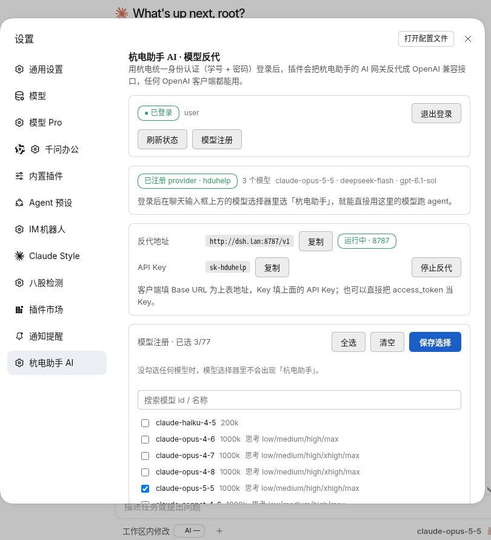
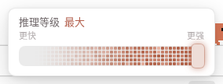

<p align="center">
  
</p>

<h1 align="center">dsh-hduhelp-ai</h1>

<p align="center">
  <a href="https://www.npmjs.com/package/dsh-hduhelp-ai">
    
  </a>
</p>

<p align="center">
  <a href="https://github.com/AlaIchhe/dsh-hduhelp-ai/releases/latest"></a>
  <a href="https://www.npmjs.com/package/dsh-hduhelp-ai"></a>
  <a href="https://github.com/AlaIchhe/dsh-hduhelp-ai/actions"></a>
  <a href="LICENSE"></a>
</p>

<p align="center">
  <sub><code>dsh plugin --profile web add dsh-hduhelp-ai</code></sub>
</p>

---

<p align="center">
  
</p>

## 能做什么

<table>
  <tr>
    <td width="50%" valign="top">
      <strong>面板登录</strong><br>
      设置里填学号和统一身份认证密码，走杭电 CAS 换 token，纯 HTTP 不需要浏览器；token 过期自动用 refresh_token 续期。
    </td>
    <td width="50%" valign="top">
      <strong>只注册你选的模型</strong><br>
      上游目录有 77 个模型，插件只把勾选的那几个注册进 DSH 模型列表，选择器保持干净。
    </td>
  </tr>
  <tr>
    <td width="50%" valign="top">
      <strong>原生多轮工具调用</strong><br>
      走 Responses 协议的 <code>function_call</code> / <code>function_call_output</code>，思考—调用—观察的 ReAct 循环不降级。
    </td>
    <td width="50%" valign="top">
      <strong>可调思考等级</strong><br>
      按上游 <code>supported_reasoning_levels</code> 暴露档位（低 / 中 / 高 / 更高 / 最大），在模型名旁边用滑杆切换，随请求以 <code>reasoning.effort</code> 下发。
    </td>
  </tr>
  <tr>
    <td width="50%" valign="top">
      <strong>额度就在手边</strong><br>
      输入框工具行、权限按钮右侧显示 5 小时 / 7 天两个窗口的用量；额度用尽时显示恢复倒计时。
    </td>
    <td width="50%" valign="top">
      <strong>OpenAI 兼容反代</strong><br>
      额外提供 <code>http://&lt;host&gt;:8787/v1</code>，chat/completions 自动翻译成 Responses（含 <code>reasoning_effort</code>），供 Cherry Studio / LobeChat / SDK 使用。
    </td>
  </tr>
</table>

<p align="center">
  
</p>

<p align="center">
  
</p>

## 开始使用

1. 装插件：

   ```bash
   dsh plugin --profile web add dsh-hduhelp-ai
   ```

2. 在 `~/.dsh/profiles/<profile>/cordis.patch.yml` 末尾加一条 loader 入口：

   ```yaml
   - insert:
       - id: hduhelp-ai
         name: 'dsh-hduhelp-ai'
         config:
           port: 8787
           apiKey: sk-hduhelp
   ```

3. 打开 DSH 设置 →「杭电助手 AI」，用学号 + 数字杭电密码登录。

4. 在「模型注册」里勾选要用的模型并保存；回到聊天，在输入框上方的模型选择器里选「杭电助手」。

> [!NOTE]
> 插件的文本用途走 **Responses** 协议（`/openai/v1/responses`），走 chat/completions 会被上游拒绝；
> 反代那边已经做了翻译，所以普通 OpenAI 客户端不用关心这件事。

> [!IMPORTANT]
> 账号密码只用于换取 token，不落盘：`~/.dsh/hduhelp-ai/token.json` 里只有 access/refresh token（0600）。
> 面板接口要求 `X-DSH-HDUHelp: 1` 头并校验 Host，跨站页面无法静默调用。
> 反代默认监听 `0.0.0.0:8787`，只建议在内网使用；公网部署请改成 `127.0.0.1` 或加前置鉴权。
> 本项目只做协议转换与本地反代，请在你的账号额度内使用，并遵守学校与杭电助手的使用规则。

## 反代

| 路由 | 说明 |
|---|---|
| `GET  /v1/models` | 上游模型目录 |
| `POST /v1/chat/completions` | 翻译成 Responses，流式 / 非流式都支持 |
| `POST /v1/responses` | 原样透传 |
| `POST /v1/embeddings`、`/v1/images/*`、`/v1/rerank` | 透传 |

```bash
curl http://127.0.0.1:8787/v1/chat/completions \
  -H 'Authorization: Bearer sk-hduhelp' \
  -H 'Content-Type: application/json' \
  -d '{"model":"deepseek-flash","messages":[{"role":"user","content":"你好"}],"stream":true}'
```

API Key 默认 `sk-hduhelp`，也可以直接把 `access_token` 当 key 传。

## 配置

| 键 | 默认 | 说明 |
|---|---|---|
| `port` | `8787` | 反代端口，`0` 表示不自动启动 |
| `host` | `0.0.0.0` | 反代监听地址 |
| `purpose` | `app.mate.chat` | 固定用途，插件只暴露 chat 这一条入口 |
| `apiKey` | `sk-hduhelp` | 客户端用的 key |
| `defaultModel` | 空 | 请求没带 model 时补的值 |
| `dataDir` | `~/.dsh/hduhelp-ai` | token / 勾选集 / 模型缓存目录 |

## 工作原理

```text
学号 + 密码
  → GET  /identity/login/url?grant-key=cas&client_id=poplar
  → 解析 CAS 登录页的 login-croypto(AES key) 与 flowkey
  → POST /login 表单（AES-128-ECB + PKCS#7 加密，captcha_payload=AES("{}")）
  → 302 → /identity/login/sso?state&ticket → /auth/callback?code=
  → POST /identity/login/exchange {code} → access_token / refresh_token
```

额度来自响应头：`x-hduhelp-quota-5h-utilization` / `-5h-reset`、`x-hduhelp-quota-7d-*`，429 时附 `retry-after`。

## 卸载

```bash
dsh plugin --profile web remove dsh-hduhelp-ai
rm -rf ~/.dsh/hduhelp-ai
```

再删掉 `cordis.patch.yml` 里的 `hduhelp-ai` 条目。

---

<p align="center">
  <a href="https://github.com/AlaIchhe/dsh-hduhelp-ai/issues">反馈</a> ·
  <a href="LICENSE">License</a> ·
  <a href="https://www.npmjs.com/package/dsh-hduhelp-ai">npm</a>
</p>
